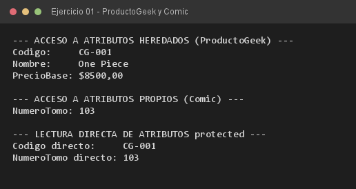

# Ejercicio 01 — ProductoGeek y Comic

**Objetivo:** relación de herencia con `extends`, separando atributos comunes y específicos.
**Salida esperada:** acceso a los atributos heredados de `ProductoGeek` y a los propios de `Comic`.

**Conceptos:** `extends` · `protected` · `super(...)` · constructor parametrizado · getters/setters



```bash
javac -encoding UTF-8 -d bin -sourcepath src src/ejercitacion3_1/ejercicio01/Comic.java
java -cp bin ejercitacion3_1.ejercicio01.Comic
```
