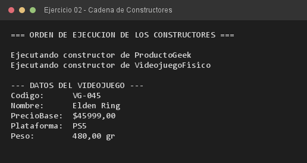

# Ejercicio 02 — VideojuegoFisico

**Objetivo:** orden de ejecución de los constructores en una jerarquía y obligatoriedad de `super(...)`.
**Salida esperada:** mensajes que demuestran que la superclase se construye primero.

**Conceptos:** `super(...)` · cadena de constructores · orden de inicialización



```bash
javac -encoding UTF-8 -d bin -sourcepath src src/ejercitacion3_1/ejercicio02/VideojuegoFisico.java
java -cp bin ejercitacion3_1.ejercicio02.VideojuegoFisico
```
