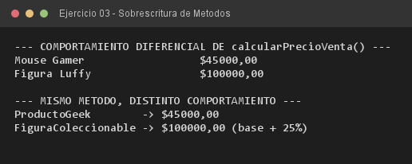

# Ejercicio 03 — FiguraColeccionable

**Objetivo:** sobrescritura de métodos con `@Override` adaptando el comportamiento heredado.
**Salida esperada:** precio de venta distinto entre un `ProductoGeek` y una figura de edición limitada.

**Conceptos:** `@Override` · sobrescritura · `super.calcularPrecioVenta()` · `if` de negocio



```bash
javac -encoding UTF-8 -d bin -sourcepath src src/ejercitacion3_1/ejercicio03/FiguraColeccionable.java
java -cp bin ejercitacion3_1.ejercicio03.FiguraColeccionable
```
