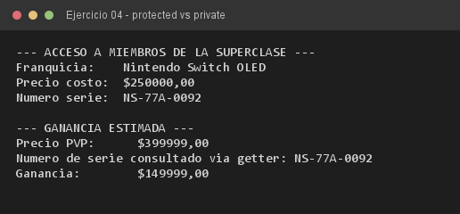

# Ejercicio 04 — ConsolaEdicionEspecial

**Objetivo:** diferenciar el acceso `protected` del `private` dentro de una jerarquía de clases.
**Salida esperada:** ganancia estimada usando el costo heredado y el número de serie vía getter.

**Conceptos:** `protected` · `private` · getter público · herencia de constructores



```bash
javac -encoding UTF-8 -d bin -sourcepath src src/ejercitacion3_1/ejercicio04/ConsolaEdicionEspecial.java
java -cp bin ejercitacion3_1.ejercicio04.ConsolaEdicionEspecial
```
