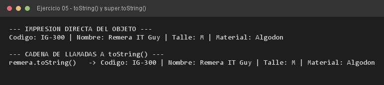

# Ejercicio 05 — IndumentariaGeek

**Objetivo:** herencia implícita de `java.lang.Object` y sobrescritura de `toString()`.
**Salida esperada:** una remera impresa directamente, reutilizando `super.toString()`.

**Conceptos:** `@Override` · `toString()` · `super.toString()` · concatenación



```bash
javac -encoding UTF-8 -d bin -sourcepath src src/ejercitacion3_1/ejercicio05/IndumentariaGeek.java
java -cp bin ejercitacion3_1.ejercicio05.IndumentariaGeek
```
