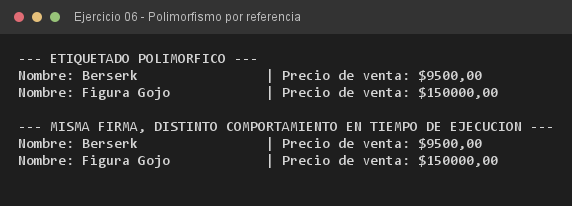

# Ejercicio 06 — GestorEtiquetado

**Objetivo:** usar una referencia de la superclase para manipular objetos de distintas subclases.
**Salida esperada:** etiquetas con el precio de venta resuelto polimórficamente en tiempo de ejecución.

**Conceptos:** polimorfismo · dynamic binding · referencia de superclase · paso de objetos



```bash
javac -encoding UTF-8 -d bin -sourcepath src src/ejercitacion3_1/ejercicio06/GestorEtiquetado.java
java -cp bin ejercitacion3_1.ejercicio06.GestorEtiquetado
```
