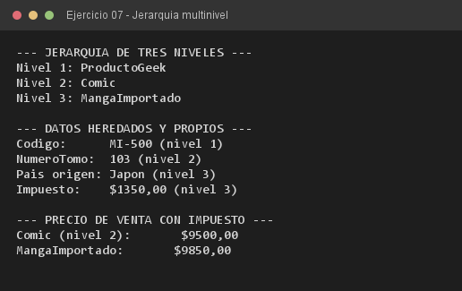

# Ejercicio 07 — MangaImportado

**Objetivo:** modelar una jerarquía multinivel y la propagación de atributos y constructores.
**Salida esperada:** datos heredados por nivel y precio de venta con impuesto de aduana.

**Conceptos:** herencia multinivel · `super(...)` en cadena · sobrescritura acumulativa



```bash
javac -encoding UTF-8 -d bin -sourcepath src src/ejercitacion3_1/ejercicio07/MangaImportado.java
java -cp bin ejercitacion3_1.ejercicio07.MangaImportado
```
