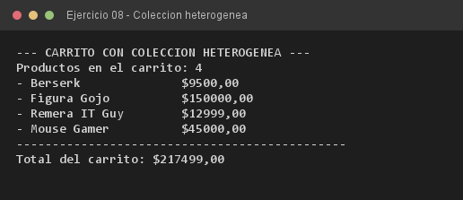

# Ejercicio 08 — CarritoCompras

**Objetivo:** guardar instancias de distintas subclases en una única colección genérica.
**Salida esperada:** detalle de los productos heterogéneos y el total acumulado del carrito.

**Conceptos:** `ArrayList<ProductoGeek>` · for-each · llamada polimórfica · colección heterogénea



```bash
javac -encoding UTF-8 -d bin -sourcepath src src/ejercitacion3_1/ejercicio08/CarritoCompras.java
java -cp bin ejercitacion3_1.ejercicio08.CarritoCompras
```
