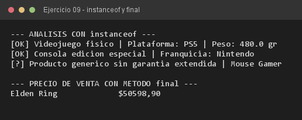

# Ejercicio 09 — VerificadorGarantia

**Objetivo:** inspección de tipos con `instanceof`, downcasting seguro y efecto de `final`.
**Salida esperada:** diagnóstico de cada producto según su subclase real.

**Conceptos:** `instanceof` · downcasting · `final` en métodos · restricción del compilador



```bash
javac -encoding UTF-8 -d bin -sourcepath src src/ejercitacion3_1/ejercicio09/VerificadorGarantia.java
java -cp bin ejercitacion3_1.ejercicio09.VerificadorGarantia
```
