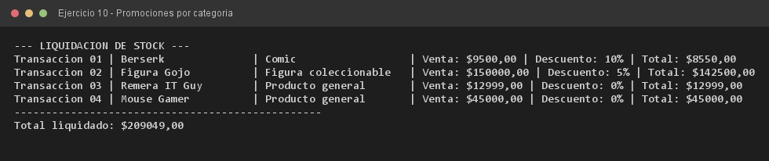

# Ejercicio 10 — PromocionGeek

**Objetivo:** integrar herencia, sobrescritura, encadenamiento de constructores y diseño encapsulado.
**Salida esperada:** liquidación de stock con el descuento de cada categoría y el total final.

**Conceptos:** `instanceof` · descuentos por categoría · `ArrayList` heterogéneo · polimorfismo



```bash
javac -encoding UTF-8 -d bin -sourcepath src src/ejercitacion3_1/ejercicio10/PromocionGeek.java
java -cp bin ejercitacion3_1.ejercicio10.PromocionGeek
```
