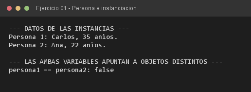

# Ejercicio 01 — Persona

**Objetivo:** definir una clase, declarar atributos de instancia y comprender la instanciación en el Heap con `new`.
**Salida esperada:** datos de dos instancias creadas y asignados con el operador punto.

**Conceptos:** clase · atributos de instancia · operador `new` · Stack vs Heap · operador punto



```bash
javac -encoding UTF-8 -d bin -sourcepath src src/ejercitacion3_2/ejercicio01/Persona.java
java -cp bin ejercitacion3_2.ejercicio01.Persona
```
