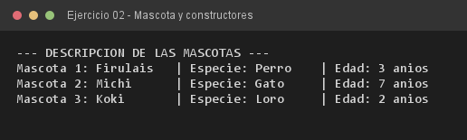

# Ejercicio 02 — Mascota

**Objetivo:** usar constructores parametrizados para garantizar un estado inicial íntegro.
**Salida esperada:** descripción de tres instancias formateada con `String.format()`.

**Conceptos:** constructor parametrizado · referencia `this` · `String.format()` · encapsulamiento



```bash
javac -encoding UTF-8 -d bin -sourcepath src src/ejercitacion3_2/ejercicio02/Mascota.java
java -cp bin ejercitacion3_2.ejercicio02.Mascota
```
