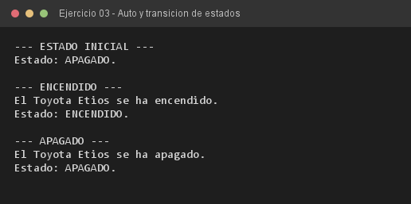

# Ejercicio 03 — Auto

**Objetivo:** diseñar métodos de instancia `void` que alteren el estado interno de la entidad.
**Salida esperada:** secuencia de encendido, verificación de estado y apagado del vehículo.

**Conceptos:** métodos `void` · primitivo `boolean` · mutación de estado · `if/else`



```bash
javac -encoding UTF-8 -d bin -sourcepath src src/ejercitacion3_2/ejercicio03/Auto.java
java -cp bin ejercitacion3_2.ejercicio03.Auto
```
