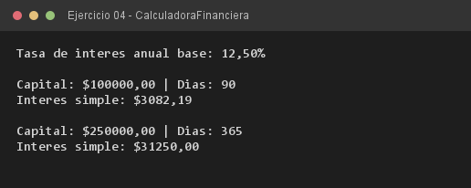

# Ejercicio 04 — CalculadoraFinanciera

**Objetivo:** implementar métodos que devuelven valores calculados con `return`.
**Salida esperada:** dos cálculos de interés simple con distintos capitales y plazos.

**Conceptos:** retorno de valores · fórmula de interés simple · `double` · días del año



```bash
javac -encoding UTF-8 -d bin -sourcepath src src/ejercitacion3_2/ejercicio04/CalculadoraFinanciera.java
java -cp bin ejercitacion3_2.ejercicio04.CalculadoraFinanciera
```
