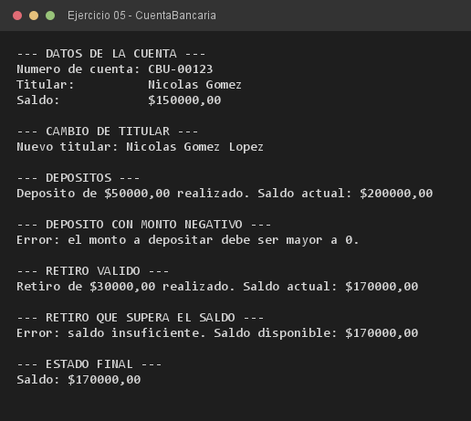

# Ejercicio 05 — CuentaBancaria

**Objetivo:** aplicar ocultamiento de datos con `private` y acceso controlado.
**Salida esperada:** depósito, retiro y los rechazos de las operaciones no permitidas.

**Conceptos:** `private` · getters/setters · métodos de negocio · validación de invariantes



```bash
javac -encoding UTF-8 -d bin -sourcepath src src/ejercitacion3_2/ejercicio05/CuentaBancaria.java
java -cp bin ejercitacion3_2.ejercicio05.CuentaBancaria
```
