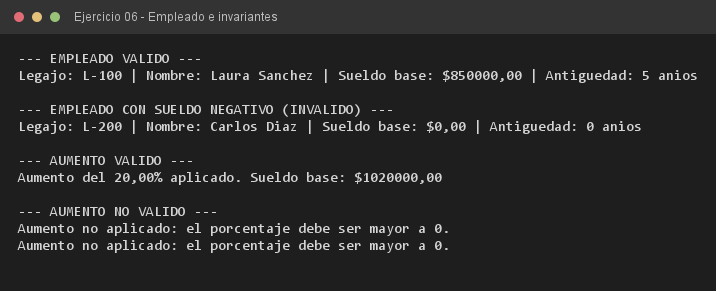

# Ejercicio 06 — Empleado

**Objetivo:** garantizar que el estado del objeto se mantenga siempre dentro de límites válidos.
**Salida esperada:** sueldo y antigüedad corregidos ante valores inválidos y aumento rechazado.

**Conceptos:** invariante de clase · constructor defensivo · validación · método de negocio



```bash
javac -encoding UTF-8 -d bin -sourcepath src src/ejercitacion3_2/ejercicio06/Empleado.java
java -cp bin ejercitacion3_2.ejercicio06.Empleado
```
