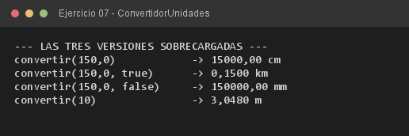

# Ejercicio 07 — ConvertidorUnidades

**Objetivo:** comprender la sobrecarga de métodos según su firma y la resolución estática.
**Salida esperada:** las tres variantes de `convertir()` ejecutadas con la firma adecuada.

**Conceptos:** overloading · firma del método · static binding · `double` vs `int`



```bash
javac -encoding UTF-8 -d bin -sourcepath src src/ejercitacion3_2/ejercicio07/ConvertidorUnidades.java
java -cp bin ejercitacion3_2.ejercicio07.ConvertidorUnidades
```
