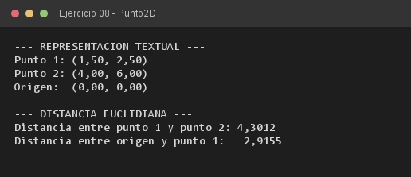

# Ejercicio 08 — Punto2D

**Objetivo:** sobrescribir `toString()` heredado de `java.lang.Object` para representar el estado.
**Salida esperada:** dos puntos impresos directamente y la distancia euclidiana entre ambos.

**Conceptos:** `toString()` · constructores sobrecargados · `Math.sqrt()` · paso por referencia



```bash
javac -encoding UTF-8 -d bin -sourcepath src src/ejercitacion3_2/ejercicio08/Punto2D.java
java -cp bin ejercitacion3_2.ejercicio08.Punto2D
```
