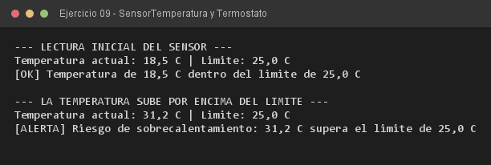

# Ejercicio 09 — SensorTemperatura y Termostato

**Objetivo:** interactuar entre instancias pasando referencias y exchanging mensajes.
**Salida esperada:** evaluación de riesgo con la temperatura dentro y fuera del límite.

**Conceptos:** asociación · paso de mensajes · getter como consulta · colaboración entre objetos



```bash
javac -encoding UTF-8 -d bin -sourcepath src src/ejercitacion3_2/ejercicio09/SensorTemperatura.java
java -cp bin ejercitacion3_2.ejercicio09.SensorTemperatura
```
