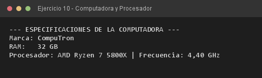

# Ejercicio 10 — Computadora y Procesador

**Objetivo:** modelar una agregación usando un tipo de referencia como atributo de instancia.
**Salida esperada:** especificaciones de la computadora con los datos del procesador delegados.

**Conceptos:** agregación · atributo de referencia · delegación · `toString()` · getters



```bash
javac -encoding UTF-8 -d bin -sourcepath src src/ejercitacion3_2/ejercicio10/Computadora.java
java -cp bin ejercitacion3_2.ejercicio10.Computadora
```
